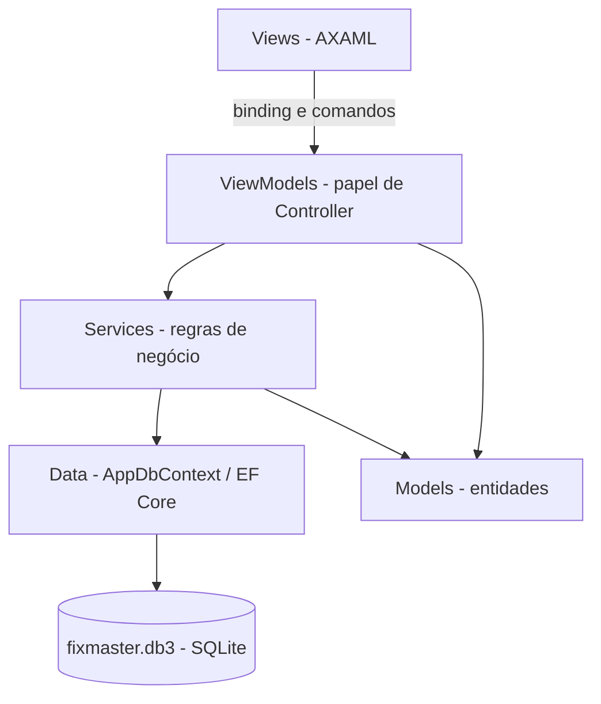

# Fix_Master

## Arquitetura

## Visão geral

O documento define o padrão **MVC** e recomenda manter o acesso ao banco fora dos controladores. O Avalonia trabalha naturalmente com **MVVM**, e o template do projeto já traz `ViewModels/`. A proposta é tratar a **ViewModel como o Controller** (recebe a ação do usuário, chama os serviços e prepara o resultado para a View) e registrar isso na documentação como "MVC adaptado ao Avalonia (ViewModel no papel de controlador)". Assim a separação de responsabilidades do RNF01 é mantida sem lutar contra o framework.

## Camadas e responsabilidades

| Camada | Pasta | Faz | Não faz |
|---|---|---|---|
| Model | `Models/` | Entidades, enums, propriedades | Acesso a banco, UI |
| View | `Views/` | Layout AXAML, estilos, controles | Regras de negócio, consultas |
| ViewModel (Controller) | `ViewModels/` | Estado da tela, comandos, navegação, chama serviços | Usar `DbContext` direto |
| Service | `Services/` | Validações, regras, transações | Conhecer controles de UI |
| Data | `Data/` | `AppDbContext`, mapeamentos, migrações, seed | Regras de negócio |

## Decisões

1. **Contexto curto por operação.** Aplicativo desktop de longa duração + `DbContext` único = dados obsoletos e erros de rastreamento. Registrar `IDbContextFactory<AppDbContext>` e criar um contexto por operação de serviço.
2. **Regras no serviço, restrições no banco.** Validar no serviço (mensagem amigável) e também no banco (índices únicos, `CHECK`, chaves estrangeiras) como rede de segurança.
3. **Transações explícitas** em operações de múltiplas tabelas (conclusão de OS).
4. **Resultado tipado.** Serviços retornam `Resultado`/`Resultado<T>` (Ok ou Falha + mensagem) em vez de lançar exceção para erros de negócio.
5. **Navegação por ViewModel.** `MainViewModel.CurrentScreen` hospeda `LoginViewModel` e depois `ShellViewModel`; o Shell troca `CurrentPage` conforme o item de menu. Cada ViewModel é associado à View por `DataTemplate`.
6. **Offline por construção.** Nenhum pacote ou recurso que dependa de rede em tempo de execução; fontes e ícones em `Assets/`.
7. **Portabilidade.** Caminho do banco via `Environment.SpecialFolder.LocalApplicationData`; evitar APIs exclusivas de Windows.

## Backlog do FixMaster

Backlog completo do sistema: montagem da arquitetura, todas as funcionalidades e a geração dos executáveis. Os itens marcados como *(sugestão)* não estão no documento original; avalie se entram no escopo.

## Como ler

- **Prioridade (MoSCoW)**: Must = necessário para atender o documento; Should = importante; Could = se sobrar tempo.
- **Pontos**: escala de esforço relativo (1, 2, 3, 5, 8). Não são horas; calibre depois da primeira feature.
- **Ref.**: história (US), requisito (RF/RNF) ou seção do documento de origem.
- Detalhes de cada feature e história: pasta `features/` e `stories/`. Versão em planilha: `backlog.csv`.

## Resumo

| Épico | Itens | Pontos | Must |
|---|---|---|---|
| ARQ — Arquitetura e fundação (F06) | 14 | 36 | 23 |
| LOG — Login local (F00) | 5 | 12 | 8 |
| CLI — Clientes (F01) | 6 | 16 | 16 |
| EST — Estoque e localização (F02) | 9 | 28 | 23 |
| AGE — Agenda e calendário (F03) | 7 | 25 | 23 |
| OS — Ordens de serviço e baixa de estoque (F04) | 6 | 26 | 21 |
| DSH — Dashboard operacional (F05) | 3 | 9 | 9 |
| REL — Relatórios, backup e configurações (opcionais) | 4 | 15 | 0 |
| QLD — Qualidade e validação | 4 | 10 | 5 |
| PUB — Empacotamento e distribuição | 9 | 30 | 11 |
| **Total** | **67** | **207** | **139** |

## Plano sugerido por sprint

Sem datas fixas, ajuste ao prazo da disciplina. Cada sprint termina com algo executável.

| Sprint | Foco | Itens |
|---|---|---|
| 0 | Fundação | ARQ-01 a ARQ-12 |
| 1 | Acesso e primeiro CRUD | LOG-01 a LOG-03, CLI-01 a CLI-06 |
| 2 | Estoque | EST-01 a EST-07 |
| 3 | Agenda | AGE-01 a AGE-07 |
| 4 | OS e dashboard | OS-01 a OS-05, DSH-01 a DSH-03 |
| 5 | Qualidade e entrega | QLD-01 a QLD-04, PUB-01 a PUB-09, ARQ-13/14 |
| Extra | Se houver tempo | Itens *Could* e REL-03 (backup) |

## Épico ARQ — Arquitetura e fundação (F06)

Processos de montagem da base técnica. Nada de funcionalidade de negócio ainda, mas sem isso nada anda.

| ID | História | Descrição / critérios | Prio. | Pts | Depende de | Ref. |
|---|---|---|---|---|---|---|
| ARQ-01 | Como desenvolvedor, quero um repositório organizado com board, para acompanhar o trabalho e dar acesso ao tutor. | Organizar o repositório GitHub (branches `main` e `develop`), criar o GitHub Project (A fazer / Em andamento / Em revisão / Pronto), gerar issues a partir deste backlog, identificar o aluno no README e dar acesso ao professor (RNF10). | Must | 2 | — | RNF10 |
| ARQ-02 | Como desenvolvedor, quero a estrutura de pastas por camada, para separar responsabilidades. | Criar `Models`, `Data`, `Services`, `ViewModels`, `Views`, `Themes`, `Converters`, `Infrastructure`, `Assets` e o projeto `FixMaster.Tests`, conforme `02-ESTRUTURA-DE-ARQUIVOS`. | Must | 1 | ARQ-01 | RNF01 |
| ARQ-03 | Como desenvolvedor, quero as dependências instaladas, para usar EF Core, SQLite e MVVM. | Instalar `Microsoft.EntityFrameworkCore.Sqlite`, `.Design`, `CommunityToolkit.Mvvm`, `Microsoft.Extensions.DependencyInjection` e a ferramenta `dotnet-ef`; registrar as versões no README. | Must | 1 | ARQ-02 | RNF02, RNF03 |
| ARQ-04 | Como desenvolvedor, quero o `AppDbContext` com o banco local, para persistir os dados offline. | Criar `AppDbContext`; definir o caminho de `fixmaster.db3` na pasta de dados do usuário (criando a pasta se necessário); confirmar por teste que as chaves estrangeiras estão ativas. | Must | 3 | ARQ-03 | RNF03, RNF06 |
| ARQ-05 | Como desenvolvedor, quero migrações versionadas, para reproduzir o esquema do banco em qualquer máquina. | Gerar a migração `Inicial`, aplicar `Database.Migrate()` na inicialização e documentar o processo (exigido na seção 2.11 do documento). O arquivo `.db3` não é versionado. | Must | 2 | ARQ-04 | RNF06, 2.11 |
| ARQ-06 | Como desenvolvedor, quero injeção de dependência, para desacoplar ViewModels e serviços. | Configurar `ServiceCollection`, registrar `IDbContextFactory<AppDbContext>` e os serviços; resolver ViewModels pela DI. | Must | 2 | ARQ-04 | RNF01, RNF07 |
| ARQ-07 | Como operador, quero mensagens de erro compreensíveis, para não perder o trabalho quando algo falha. | Criar `Resultado`; capturar exceções não tratadas, mostrar mensagem amigável e gravar log em arquivo local (sem rede). | Should | 3 | ARQ-06 | RNF08, RNF09 |
| ARQ-08 | Como operador, quero a identidade visual aplicada em todo o app, para ter uma interface consistente. | Importar `Colors.axaml` e `StarfieldStyles.axaml` no `App.axaml`, tema escuro, checar contraste dos pares texto/fundo. | Must | 2 | ARQ-02 | RNF02 |
| ARQ-09 | Como operador, quero um menu lateral para alternar entre módulos, para navegar sem me perder. | Implementar `MainViewModel.CurrentScreen` (Login → Shell), `ShellViewModel`, `INavigationService`, `DataTemplate` ViewModel→View e itens de menu (Dashboard, Agenda, Clientes, Estoque, Ordens). | Must | 5 | ARQ-06, ARQ-08 | 2.5 |
| ARQ-10 | Como desenvolvedor, quero componentes visuais reutilizáveis, para não repetir XAML. | Criar `StarfieldPanel`, `StatusBadge`, `StatCard` e `HintBar`. | Should | 5 | ARQ-08 | RNF02 |
| ARQ-11 | Como operador, quero fontes e ícones dentro do aplicativo, para ele funcionar sem internet. | Embutir fontes e ícones em `Assets/` (como `AvaloniaResource`); proibir CDN e recursos remotos. | Must | 2 | ARQ-08 | RNF09, US10 |
| ARQ-12 | Como desenvolvedor, quero um projeto de testes, para validar as regras de negócio. | Criar `FixMaster.Tests` (xUnit) com helper de SQLite em memória (conexão aberta durante o teste). | Must | 3 | ARQ-04 | RNF07 |
| ARQ-13 | Como operador, quero usar o teclado, para trabalhar mais rápido no balcão. | Foco visível, ordem de tabulação, atalhos globais (ex.: ESC voltar) e `HintBar` refletindo a tela ativa. | Should | 3 | ARQ-09, ARQ-10 | RNF08 |
| ARQ-14 | Como autor do documento, quero a documentação alinhada ao código, para a avaliação refletir o que foi feito. | Atualizar a seção 2.1 (MVC adaptado, ViewModel como controller), o DER e o diagrama de classes com os ajustes do arquivo 04. | Should | 2 | ARQ-05 | 2.1, 2.7, 2.9 |

## Épico LOG — Login local (F00)

Controle de acesso do prestador.

| ID | História | Descrição / critérios | Prio. | Pts | Depende de | Ref. |
|---|---|---|---|---|---|---|
| LOG-01 | Como operador, quero informar usuário e senha ao abrir o programa, para proteger meus dados. | Tela de login, autenticação via `AuthService`, mensagem genérica para qualquer falha, módulos bloqueados sem autenticação. | Must | 3 | ARQ-09 | US01, RF01 |
| LOG-02 | Como operador, quero que minha senha seja guardada com segurança, para que ela não possa ser lida do banco. | `PasswordHasher` com PBKDF2 + sal aleatório e comparação em tempo constante; testes unitários. | Must | 2 | ARQ-04 | RF01, RNF06 |
| LOG-03 | Como operador, quero criar meu usuário no primeiro uso, para não existir senha padrão. | Se a tabela `Usuarios` estiver vazia, exibir tela de criação do operador antes do login. | Must | 3 | LOG-02 | RF01 |
| LOG-04 | Como operador, quero encerrar a sessão, para deixar o computador sem expor o sistema. *(sugestão)* | Item “Sair” no menu: volta para a tela de login e descarta o estado das ViewModels. | Should | 2 | LOG-01 | — |
| LOG-05 | Como operador, quero trocar minha senha, para mantê-la segura. *(sugestão)* | Tela de alteração exigindo a senha atual. | Could | 2 | LOG-01 | — |

## Épico CLI — Clientes (F01)

Cadastro de pessoas físicas e jurídicas.

| ID | História | Descrição / critérios | Prio. | Pts | Depende de | Ref. |
|---|---|---|---|---|---|---|
| CLI-01 | Como operador, quero cadastrar cliente pessoa física, para registrar quem me chama em casa. | Formulário com nome, CPF, telefone e endereço. | Must | 3 | ARQ-09 | US02, RF02 |
| CLI-02 | Como operador, quero cadastrar empresas, para atender lojas e escritórios. | Alternância PF/PJ no formulário; CNPJ no lugar do CPF. | Must | 2 | CLI-01 | US02, RF02 |
| CLI-03 | Como operador, quero que o documento seja validado e único, para evitar cadastros duplicados. | `DocumentoValidator` (dígitos verificadores de CPF/CNPJ) + índice único + mensagem de erro no campo. | Must | 3 | CLI-01 | US02, RNF06 |
| CLI-04 | Como operador, quero buscar clientes, para achá-los depois. | Busca por nome, telefone ou documento, com resultado ao digitar. | Must | 3 | CLI-01 | US02 |
| CLI-05 | Como operador, quero atualizar os dados do cliente, para manter o cadastro correto. | Edição reaproveitando o formulário, com as mesmas validações. | Must | 2 | CLI-01 | RF02 |
| CLI-06 | Como operador, quero excluir ou inativar clientes, sem quebrar o histórico. | Sem vínculos: exclui. Com agendamento/OS: inativa (`Ativo = false`) ou bloqueia com mensagem; inativos somem das buscas padrão. | Must | 3 | CLI-01 | RF02, 2.3 |

## Épico EST — Estoque e localização (F02)

Materiais e ferramentas com endereçamento físico A–G × 1–8.

| ID | História | Descrição / critérios | Prio. | Pts | Depende de | Ref. |
|---|---|---|---|---|---|---|
| EST-01 | Como operador, quero cadastrar materiais e ferramentas, para controlar o que tenho. | Formulário com código, nome, descrição, categoria, quantidade e preço unitário; código único. | Must | 3 | ARQ-09 | RF03 |
| EST-02 | Como operador, quero que só coordenadas válidas sejam aceitas, para o sistema espelhar meu depósito. | `LocalizacaoValidator` (A–G, 1–8), `CHECK` no banco e mensagem clara. | Must | 2 | EST-01 | US04, RF04 |
| EST-03 | Como operador, quero que cada coordenada guarde um só item, para não ter dúvida de onde está cada coisa. | Índice único (Prateleira, Posicao) entre itens ativos; mensagem indicando o item que já ocupa o lugar. | Must | 2 | EST-02 | US04, 2.10.2 |
| EST-04 | Como operador, quero ver as prateleiras em uma matriz, para enxergar o depósito. | Controle `ShelfMatrix` 7×8 (A–G): livre = contorno, ocupada = preenchida; clique abre o item; lê do banco. | Must | 8 | EST-03, ARQ-10 | US04 |
| EST-05 | Como operador, quero buscar por nome, código ou tipo, para achar a peça rápido. | Busca parcial em nome, código e categoria; mensagem quando não houver resultado. | Must | 3 | EST-01 | US05, RF03 |
| EST-06 | Como operador, quero ver a coordenada bem grande, para ir direto à prateleira. | Resultado com a coordenada (ex.: `M4`) em fonte grande e destaque na matriz com a cor de acento. | Must | 2 | EST-04, EST-05 | US05 |
| EST-07 | Como operador, quero atualizar, excluir ou inativar itens, para manter o estoque correto. | Edição, exclusão sem vínculos e inativação quando já usado em OS (libera a coordenada). | Must | 3 | EST-01 | RF03 |
| EST-08 | Como operador, quero registrar a entrada de material, para repor o estoque sem editar o cadastro inteiro. *(sugestão)* | Ação “Adicionar quantidade” com validação de valor positivo. | Should | 2 | EST-01 | — |
| EST-09 | Como operador, quero ser avisado de estoque baixo, para repor antes de faltar. *(sugestão)* | Campo de estoque mínimo por item e indicador visual na lista. | Could | 3 | EST-01 | — |

## Épico AGE — Agenda e calendário (F03)

Compromissos do mês e do dia, sem conflitos.

| ID | História | Descrição / critérios | Prio. | Pts | Depende de | Ref. |
|---|---|---|---|---|---|---|
| AGE-01 | Como operador, quero um calendário mensal, para ver o movimento do mês. | Navegação entre meses; dias com atendimento indicados; seleção de data. | Must | 5 | ARQ-09 | US07, RF05 |
| AGE-02 | Como operador, quero a grade com as horas do dia, para ver o que vou fazer. | Compromissos do dia ordenados por hora, com início–fim, cliente, descrição e status; comporta 8+ compromissos. | Must | 5 | AGE-01 | US03, US07, RF06 |
| AGE-03 | Como operador, quero agendar um serviço, para organizar meu dia. | Formulário: cliente, descrição, data, início e duração; grava `DataHoraFim`; status inicial Pendente. | Must | 3 | AGE-02, CLI-01 | RF07 |
| AGE-04 | Como operador, quero que o sistema recuse horários conflitantes, para nunca marcar dois clientes juntos. | `AgendaService.BuscarConflitoAsync` (sobreposição de intervalos, ignora cancelados e o próprio registro); exibe o compromisso conflitante; testes de sobreposição, encostado e contido. | Must | 5 | AGE-03 | US08, RF07 |
| AGE-05 | Como operador, quero editar ou cancelar agendamentos, para refletir mudanças. | Edição com nova verificação de conflito; cancelamento libera o horário. | Must | 3 | AGE-04 | RF07 |
| AGE-06 | Como operador, quero marcar o andamento do serviço, para saber o que falta, o que faço e o que terminei. | Transições Pendente → Em Andamento → Concluído, com selo de cor e texto. | Must | 2 | AGE-03 | US07 |
| AGE-07 | Como operador, quero ver os detalhes de um compromisso, para me preparar. | Painel com cliente, telefone, endereço, descrição e atalho para emitir OS. | Should | 2 | AGE-02 | 2.5 |

## Épico OS — Ordens de serviço e baixa de estoque (F04)

Do atendimento ao custo final, com estoque sempre consistente.

| ID | História | Descrição / critérios | Prio. | Pts | Depende de | Ref. |
|---|---|---|---|---|---|---|
| OS-01 | Como operador, quero emitir uma OS a partir do agendamento, para registrar o que foi feito. | Uma OS por agendamento (índice único); relatório técnico e mão de obra. | Must | 5 | AGE-03 | US11, RF08 |
| OS-02 | Como operador, quero indicar os materiais usados, para controlar o consumo. | Busca no estoque, quantidade e `ValorUnitario` gravado no `ItemOS` no momento da inclusão. | Must | 3 | OS-01, EST-05 | US11, RF08 |
| OS-03 | Como operador, quero ver o valor total, para cobrar corretamente. | Total = mão de obra + Σ (quantidade × valor unitário); atenção ao tipo `decimal` no SQLite (centavos ou cálculo em memória). | Must | 2 | OS-02 | US11 |
| OS-04 | Como operador, quero concluir a OS e baixar o estoque de uma vez, para nunca ter serviço concluído com estoque errado. | `ConcluirAsync` em transação: verifica status e estoque, baixa, atualiza OS e agendamento, registra atividade; rollback em falha; idempotente; testes de sucesso, falha e dupla conclusão. | Must | 8 | OS-02, EST-07, AGE-06 | US06, RF09 |
| OS-05 | Como operador, quero consultar e atualizar OS, para corrigir informações antes de concluir. | Lista com filtros (status, cliente, período); edição bloqueada após conclusão. | Must | 3 | OS-01 | RF08 |
| OS-06 | Como operador, quero imprimir ou exportar a OS, para entregar ao cliente. *(sugestão)* | Exportar em PDF ou HTML imprimível, offline. | Could | 5 | OS-04 | — |

## Épico DSH — Dashboard operacional (F05)

Primeira tela após o login.

| ID | História | Descrição / critérios | Prio. | Pts | Depende de | Ref. |
|---|---|---|---|---|---|---|
| DSH-01 | Como operador, quero ver os números do dia, para saber como está meu dia. | Cards: marcados, pendentes, em andamento e concluídos, calculados do banco. | Must | 3 | AGE-06 | US09, RF10 |
| DSH-02 | Como sistema, quero registrar eventos relevantes, para alimentar o histórico. | Entidade `AtividadeRecente` e `IAtividadeService` chamado por agenda, OS e clientes. | Must | 3 | ARQ-05 | US09 |
| DSH-03 | Como operador, quero ver o que aconteceu há pouco, para retomar o fio do dia. | Feed ordenado do mais recente ao mais antigo (limite configurável). | Must | 3 | DSH-02 | US09, RF10 |

## Épico REL — Relatórios, backup e configurações (opcionais)

Itens citados no documento como possíveis (seção 2.5) ou necessários para um sistema 100% local.

| ID | História | Descrição / critérios | Prio. | Pts | Depende de | Ref. |
|---|---|---|---|---|---|---|
| REL-01 | Como operador, quero um relatório de serviços por período, para acompanhar o faturamento. | Filtro por datas, totais por status e valor. | Could | 5 | OS-04 | 2.5 |
| REL-02 | Como operador, quero um relatório de estoque, para planejar compras. | Lista por categoria e localização, com quantidades. | Could | 3 | EST-07 | 2.5 |
| REL-03 | Como operador, quero fazer backup e restaurar o banco, para não perder tudo se o computador falhar. | Copiar `fixmaster.db3` para uma pasta escolhida (com o app em estado consistente) e restaurar com confirmação. | Should | 5 | ARQ-05 | RNF09 |
| REL-04 | Como operador, quero uma tela de configurações, para ajustar o app. | Dados do prestador, pasta de backup, tamanho do feed. | Could | 2 | ARQ-09 | 2.5 |

## Épico QLD — Qualidade e validação

Verificação dos requisitos antes da entrega.

| ID | História | Descrição / critérios | Prio. | Pts | Depende de | Ref. |
|---|---|---|---|---|---|---|
| QLD-01 | Como avaliador, quero medidas de desempenho, para confirmar a meta de < 1 s. | Medir consultas e gravações comuns com volume representativo e registrar ambiente e resultado. | Should | 3 | EST-07, AGE-05 | RNF04 |
| QLD-02 | Como avaliador, quero provas de integridade, para confiar nos dados. | Testes de FK, `CHECK`, índices únicos e rollback de transação. | Must | 3 | OS-04 | RNF06 |
| QLD-03 | Como operador, quero que tudo funcione sem internet, para trabalhar no depósito. | Roteiro manual com rede desligada: login, clientes, estoque, agenda, OS, dashboard. | Must | 2 | OS-04 | US10, RNF09 |
| QLD-04 | Como autor, quero validar o sistema com o roteiro da entrevista, para provar que atende as 10 necessidades. | Percorrer as perguntas 1–10 e registrar evidências (capturas de tela). | Should | 2 | DSH-03 | 2.2 |

## Épico PUB — Empacotamento e distribuição

Gerar e testar executáveis para Windows, Linux e macOS. Passo a passo em `05-PUBLICACAO-EXECUTAVEIS`.

| ID | História | Descrição / critérios | Prio. | Pts | Depende de | Ref. |
|---|---|---|---|---|---|---|
| PUB-01 | Como usuário, quero um executável para Windows, para rodar sem instalar o .NET. | `dotnet publish -r win-x64` self-contained, arquivo único; teste em máquina limpa. | Must | 3 | ARQ-05 | RNF05 |
| PUB-02 | Como usuário, quero um executável para Linux, para rodar na minha distribuição. | `dotnet publish -r linux-x64`; permissão de execução; lista de dependências do sistema. | Must | 3 | ARQ-05 | RNF05 |
| PUB-03 | Como usuário, quero um aplicativo para macOS, para rodar no meu Mac. | Publicar `osx-arm64` e `osx-x64`, montar o `.app`, assinar ad hoc; documentar o aviso do Gatekeeper. | Should | 5 | ARQ-05 | RNF05 |
| PUB-04 | Como desenvolvedor, quero ícone e metadados do app, para ele parecer um produto. | `.ico` (Windows), `.png` (Linux), `.icns` (macOS), versão, nome e descrição. | Should | 2 | ARQ-08 | — |
| PUB-05 | Como desenvolvedor, quero um script de publicação, para gerar todos os pacotes com um comando. | `scripts/publish.sh <versão>` gera `dist/FixMaster-<versão>-<rid>.zip`. | Must | 2 | PUB-01, PUB-02 | — |
| PUB-06 | Como desenvolvedor, quero um pipeline no GitHub, para compilar em cada sistema operacional. | Workflow com matriz (Windows, Linux, macOS), disparado por tag `v*`, publicando artefatos. | Should | 5 | PUB-05 | RNF10 |
| PUB-07 | Como usuário, quero atalho e instalação simples, para abrir o app como qualquer outro. *(opcional)* | Instalador Inno Setup (Windows), `.desktop` (Linux), `.dmg` ou `.app` em Aplicativos (macOS). | Could | 5 | PUB-04 | — |
| PUB-08 | Como avaliador, quero evidência de instalação limpa e offline em cada plataforma, para provar a portabilidade. | Executar o roteiro QLD-03 em cada SO disponível e registrar o resultado (plataformas não testadas são declaradas como tal). | Must | 3 | PUB-01, QLD-03 | RNF05, RNF09 |
| PUB-09 | Como avaliador, quero uma release no GitHub, para baixar a versão entregue. | Tag `v1.0.0`, notas de versão e pacotes anexados. | Should | 2 | PUB-05 | RNF10 |

## Definição de pronto (vale para todo item)

- [ ] Critérios atendidos e funcionando offline
- [ ] Regras de negócio com teste automatizado
- [ ] Interface segue `03-DESIGN-STARFIELD`
- [ ] Revisado e integrado na `develop` por pull request
- [ ] Documentação atualizada, se o comportamento mudou